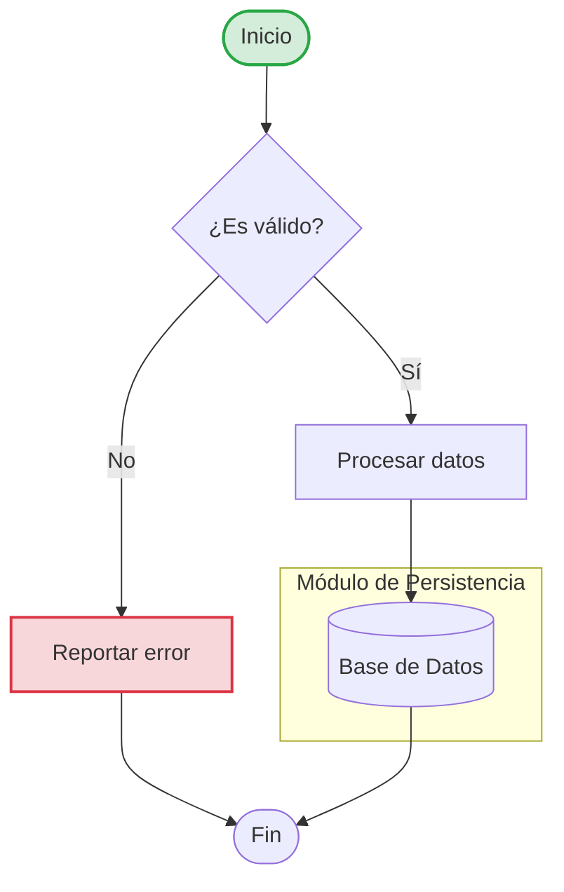
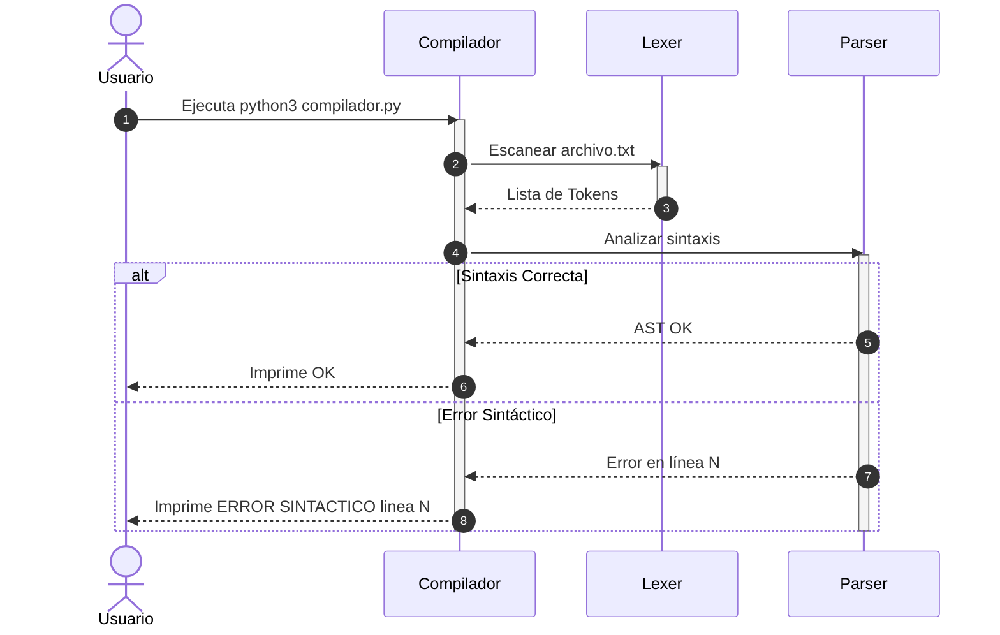
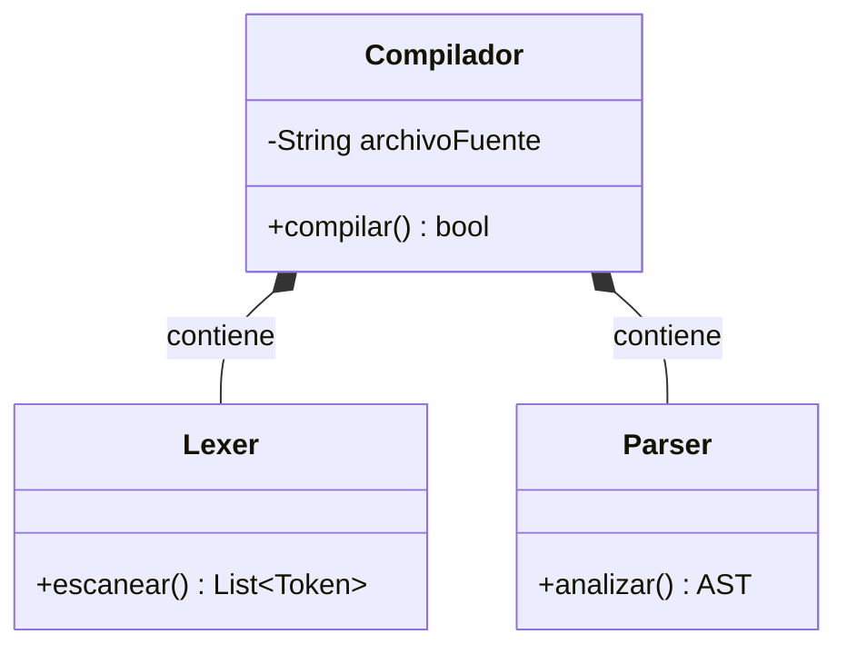
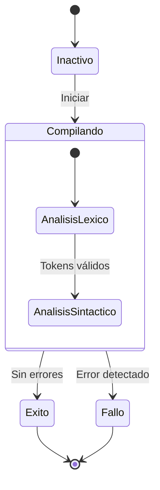
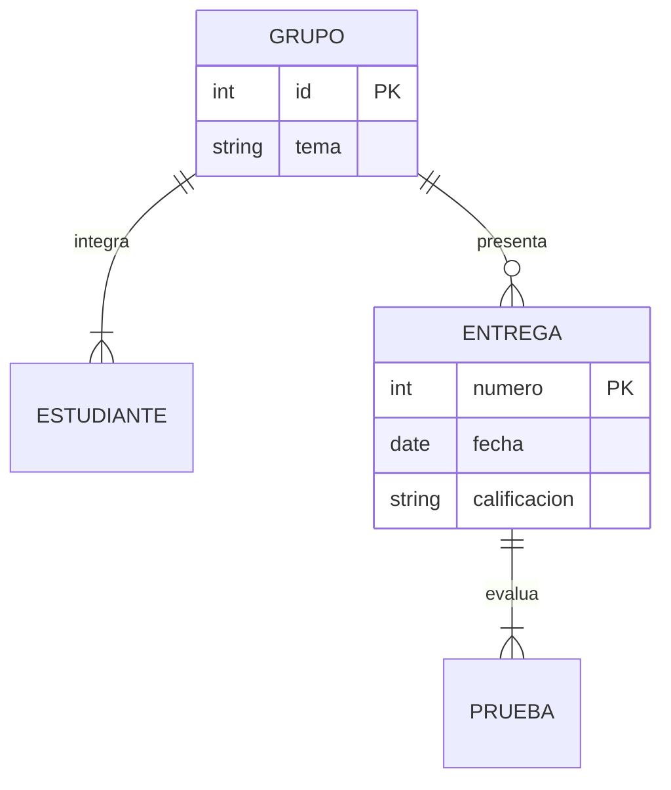
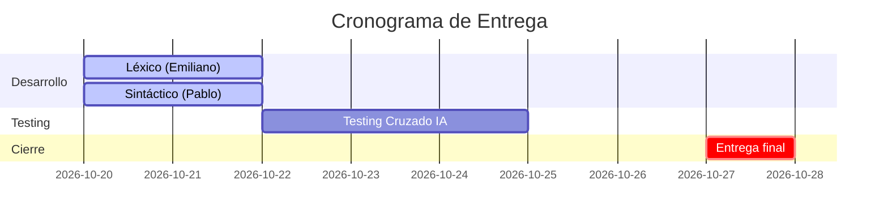
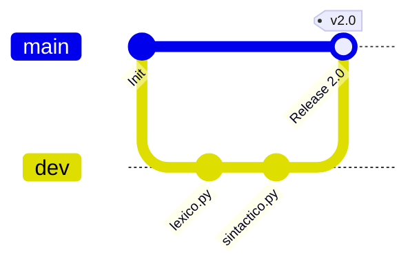

# Mermaid Diagram Skill

Guía completa para diseñar, redactar, validar y renderizar diagramas utilizando la sintaxis estándar de **Mermaid.js**, junto con la herramienta de automatización `tools/mermaid_generator.py` para exportar a **SVG** o **PNG**.

---

## 1. Herramienta de Soporte: `tools/mermaid_generator.py`

El proyecto incluye un script autónomo en Python estándar (sin dependencias adicionales obligatorias) para procesar diagramas Mermaid:

### Comandos Frecuentes

1. **Renderizar texto directo a SVG o PNG:**
   ```bash
   python tools/mermaid_generator.py --text "flowchart TD; A[Inicio]-->B[Fin]" -o img/flujo.svg
   python tools/mermaid_generator.py --text "sequenceDiagram; A->>B: Hola" -o img/secuencia.png --theme dark
   ```

2. **Renderizar desde un archivo `.mmd` o `.txt`:**
   ```bash
   python tools/mermaid_generator.py -i diagrama.mmd -o img/diagrama.svg --theme forest
   ```

3. **Extraer y renderizar todos los bloques ```` ```mermaid ```` de un archivo Markdown:**
   ```bash
   python tools/mermaid_generator.py --extract Documento.md --output-dir img/
   ```

4. **Validar sintaxis y buenas prácticas:**
   ```bash
   python tools/mermaid_generator.py --validate diagrama.mmd
   ```

5. **Obtener plantilla de ejemplo:**
   ```bash
   python tools/mermaid_generator.py --example <flowchart|sequence|class|state|er|gantt|gitGraph|pie|mindmap|timeline>
   ```

---

## 2. Reglas de Oro de Sintaxis (Evitar Errores Comunes)

1. **Entrecomillar SIEMPRE etiquetas con caracteres especiales:**
   * ❌ **Incorrecto:** `A[Proceso (Principal)]` o `B[Archivo: data.csv]` (los paréntesis y dos puntos rompen el parser).
   * ✅ **Correcto:** `A["Proceso (Principal)"]` o `B["Archivo: data.csv"]`.
2. **Evitar etiquetas HTML complejas:**
   * No usar `<div>`, `<span>` o estilos en línea dentro de los nodos. Para saltos de línea utilizar `<br/>`.
3. **Preferir `flowchart` en lugar de `graph`:**
   * `flowchart TD` y `flowchart LR` ofrecen mejor cálculo de curvas, soporte de subgrafos y formas modernas.
4. **Nombres de identificadores limpios:**
   * Usa IDs alfanuméricos simples sin espacios: `proc1["Mi Proceso"]`, no `Mi Proceso["Mi Proceso"]`.
5. **No mezclar direcciones en el mismo nivel:**
   * `TD` / `TB` (Arriba a abajo) para jerarquías y árboles.
   * `LR` (Izquierda a derecha) para procesos, pipelines y autómatas.

---

## 3. Catálogo Rápido de Diagramas Mermaid

### A. Diagramas de Flujo (`flowchart`)


* **Formas de nodos:**
  - `[Rectángulo]`
  - `(["Píldora / Terminal"])`
  - `{"Rombo / Decisión"}`
  - `[("Cilindro / BD")]`
  - `[["Subrutina"]]`
  - `(("Círculo"))`

---

### B. Diagramas de Secuencia (`sequenceDiagram`)


---

### C. Diagramas de Clases (`classDiagram`)


* **Relaciones:**
  - `<|--` Herencia
  - `*--` Composición
  - `o--` Agregación
  - `-->` Asociación
  - `..>` Dependencia

---

### D. Diagramas de Estados (`stateDiagram-v2`)


---

### E. Diagramas Entidad-Relación (`erDiagram`)


---

### F. Diagramas de Gantt (`gantt`)


---

### G. Gráficos de Git (`gitGraph`)


---

## 4. Cuándo Usar Mermaid vs. SVG Estático

| Criterio | Bloque ```` ```mermaid ```` en Markdown | SVG Exportado con `tools/` |
| :--- | :--- | :--- |
| **Ventaja principal** | 100% editable directamente en el texto | Renderizado garantizado en cualquier visor |
| **Soporte GitHub / VS Code** | Excelente (nativo) | Excelente (nativo) |
| **Soporte en visores PDF / texto plano** | Requiere conversor externo | Se incrusta directamente |
| **Recomendación de uso** | Apuntes, documentación viva, PRs | Entregas formales, README finales, informes |
