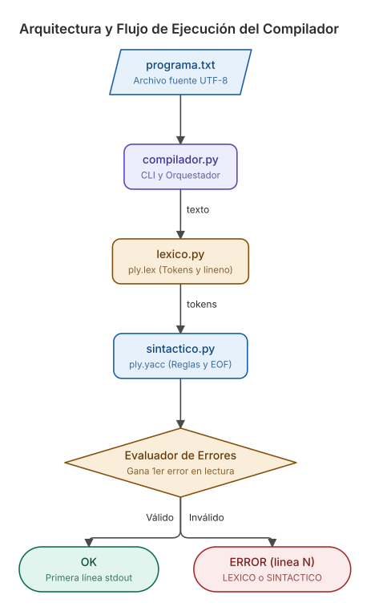
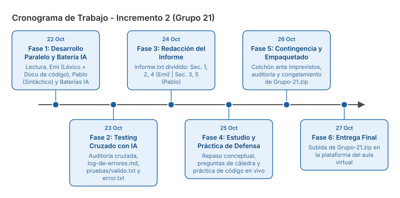
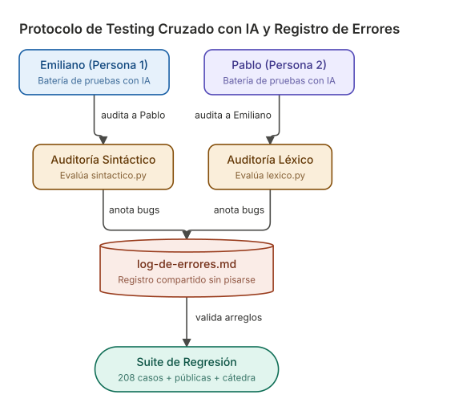

# Plan de Trabajo Detallado — Incremento 2 (Compiladores 2026)

**Facultad de Ingeniería — UCASAL**  
**Cátedra:** Compiladores 2026 (Mg. Lic. Carolina Cardoso / Ing. Miguel N. Tolaba)  
**Grupo N.º 21:** Subconjunto de Arduino (C++ para microcontrolador)  
**Integrantes:**  
- **Persona 1:** Emiliano (Emi)  
- **Persona 2:** Pablo  

**Ventana de Trabajo:** 22 de Octubre al 27 de Octubre de 2026 (6 días calendario intensivos)  
**Fecha de Entrega:** 27 de Octubre de 2026  
**Estado de Entrega 1:** **Aprobado** (100% de éxito: 9 casos públicos + 30 casos de cátedra superados).  
**Formato de Informe Acordado:** `informe.txt` (texto plano UTF-8).  

---

## 1. Visión General y Arquitectura

El objetivo del Incremento 2 es construir el compilador completo (analizador léxico y sintáctico) en Python 3 utilizando obligatoriamente la biblioteca **PLY 3.11** (`ply.lex` y `ply.yacc`). La aplicación se ejecutará desde la raíz del proyecto como:

```bash
python3 compilador.py programa.txt
```

La primera línea escrita en `stdout` debe cumplir estrictamente uno de los tres formatos:
- `OK`
- `ERROR LEXICO linea N: descripcion`
- `ERROR SINTACTICO linea N: descripcion`

> **Regla de oro:** Ante la presencia de errores múltiples, siempre debe reportarse el **primer error en el orden de lectura del archivo**.



---

## 2. Cronograma de Trabajo (22 al 27 de Octubre)

El cronograma concentra el esfuerzo en 6 jornadas altamente productivas:
- **Jueves 22/10:** Lectura, desarrollo en paralelo (Léxico y Sintáctico), integración inicial, baterías de prueba con IA y **documentación/comentarios exhaustivos del código por ambos**.
- **Viernes 23/10:** Testing cruzado con IA, registro en `log-de-errores.md` y creación de casos propios (`pruebas/valido.txt`, `error.txt`).
- **Sábado 24/10:** Redacción dividida del informe técnico (`informe.txt`).
- **Domingo 25/10:** Jornada de estudio, repaso teórico y práctica para la defensa oral (modificaciones en vivo).
- **Lunes 26/10:** Día de contingencia ante imprevistos, armado de `Grupo-21.zip` y prueba ciega.
- **Martes 27/10:** Entrega final en la plataforma virtual de la cátedra.



### Detalle del Cronograma Diario

| Fecha | Fase | Tareas Emiliano (Persona 1) | Tareas Pablo (Persona 2) | Hito / Entregable |
| :--- | :--- | :--- | :--- | :--- |
| **Jue 22/10** | **Desarrollo Paralelo & Batería IA** | 1. Lectura rápida y codificación de `lexico.py` (`ply.lex`).<br>2. **Documentar y comentar exhaustivamente el código**.<br>3. Generar batería de pruebas léxicas con IA. | 1. Lectura rápida y codificación de `sintactico.py` (`ply.yacc`).<br>2. Definición de precedencias y reglas `p_*`.<br>3. Generar batería de pruebas sintácticas con IA. | `lexico.py`, `sintactico.py` y `compilador.py` funcionales, con código bien comentado |
| **Vie 23/10** | **Testing Cruzado con IA** | 1. **Audita a Pablo**: Ejecuta su batería de pruebas sobre el Sintáctico.<br>2. Redacción de `pruebas/valido.txt` con todas las construcciones comentadas. | 1. **Audita a Emi**: Ejecuta su batería de pruebas sobre el Léxico.<br>2. Redacción de `pruebas/error.txt` y armado de `pruebas/esperado.csv`. | Todos los bugs registrados en `log-de-errores.md` y carpeta `pruebas/` lista |
| **Sáb 24/10** | **Redacción del Informe Técnico** | Redacción de secciones asignadas en `informe.txt`:<br>- **Sección 2:** Especificación y cambios.<br>- **Sección 4:** Uso de Inteligencia Artificial. | Redacción de secciones asignadas en `informe.txt`:<br>- **Sección 3:** Implementación en PLY y conflictos.<br>- **Sección 5:** Fuentes consultadas. | `informe.txt` completo y revisado cruzadamente |
| **Dom 25/10** | **Estudio y Práctica de Defensa** | Repaso conceptual de teoría léxica, autómatas y simulación de cambios en vivo sobre el lexer. | Repaso conceptual de teoría sintáctica, tablas LR/LALR y simulación de cambios en vivo sobre la gramática. | Equipo preparado para la defensa oral y modificaciones en vivo |
| **Lun 26/10** | **Día de Contingencia & Empaquetado** | Colchón libre para imprevistos técnicos o ajustes finos. Armado y validación de `Grupo-21.zip`. | Descompresión de `Grupo-21.zip` en carpeta aislada y prueba ciega de ejecución. | Archivo `Grupo-21.zip` congelado y listo para entregar |
| **Mar 27/10** | **ENTREGA FINAL** | Verificación conjunta de archivos en plataforma. | Subida formal de `Grupo-21.zip` en el aula virtual. | **ENTREGA FINALIZADA CON ÉXITO** |

---

## 3. Reparto de Roles y Tareas Específicas

### Persona 1: Emiliano (Emi)
* **Desarrollo:** Responsable principal del analizador léxico (`lexico.py`).
  - Mapeo de tokens idéntico a `tokens.txt`.
  - Diccionario de palabras reservadas (`reserved`) para evitar colisiones con identificadores.
  - Reglas para ignorar espacios/tabs y comentarios multilínea `/* ... */` sumando saltos a `lineno`.
  - Captura precisa de errores léxicos (`t_error`).
* **Tarea Clave de Documentación:** **Documentar y comentar bien el código del proyecto**:
  - Escribir comentarios claros y explicativos en cada bloque de código de `lexico.py` y `compilador.py`.
  - Documentar las expresiones regulares complejas (patrones de cadenas, números decimales, comentarios).
  - Colaborar en la claridad de los comentarios de `sintactico.py` para que todo el código del grupo mantenga un estándar uniforme, limpio y fácil de defender en el examen oral.
* **Testing:** Diseñar una batería de pruebas con IA para auditar el Parser de Pablo.
* **Casos Propios:** Redacción de `pruebas/valido.txt` utilizando **todas** las construcciones del Anexo comentadas.
* **Informe:** Redacción de las secciones 2 y 4 de `informe.txt`.

### Persona 2: Pablo
* **Desarrollo:** Responsable principal del analizador sintáctico (`sintactico.py`).
  - Mapeo de reglas gramaticales desde `gramatica.txt` a funciones `p_*` de `ply.yacc`.
  - Tabla de precedencias de operadores aritméticos (`precedence`) para eliminar ambigüedades.
  - Análisis y resolución de conflictos en `parser.out` (0 conflictos shift/reduce o reduce/reduce no justificados).
  - Manejo de errores en `p_error(p)` identificando tokens inválidos y detección de fin de archivo prematuro (EOF).
* **Testing:** Diseñar una batería de pruebas con IA para auditar el Lexer de Emiliano.
* **Casos Propios:** Redacción de `pruebas/error.txt` y armado del archivo `pruebas/esperado.csv`.
* **Informe:** Redacción de las secciones 3 y 5 de `informe.txt`.

### Tareas Conjuntas (Pair Programming)
1. Integración de `compilador.py`: mecanismo para determinar cuál error ocurrió primero en orden de lectura del archivo fuente.
2. Sección 1 del informe (Datos del grupo e integrantes).
3. Corrida masiva sobre los 208 casos de `pruebas-grupo/`.
4. Simulación de la defensa oral del 25/10.

---

## 4. División de Secciones de `informe.txt`

El informe técnico se entregará en texto plano (`informe.txt`) en UTF-8, dividiendo las responsabilidades de la siguiente manera:

| Sección | Apartado Obligatorio | Responsable | Contenido a Desarrollar |
| :---: | :--- | :---: | :--- |
| **1** | **Grupo e Integrantes** | **Emiliano y Pablo** | Número de Grupo (21), nombres completos, rol de cada uno. |
| **2** | **Especificación** | **Emiliano** | Declarar que no hubo cambios respecto a la Entrega 1 aprobada (100% de éxito en los 39 casos de prueba evaluados). |
| **3** | **Implementación** | **Pablo** | Cómo se tradujo la gramática a PLY (`ply.yacc`), tabla de precedencias, reporte de conflictos en `parser.out` y decisiones tomadas en la detección y mensajes de error sintáctico. |
| **4** | **Uso de Inteligencia Artificial** | **Emiliano** | Cumplimiento estricto de la sección 13 del enunciado: herramientas utilizadas, consultas realizadas, generación de baterías de pruebas, aportes obtenidos y cómo fueron verificados y adaptados por el grupo. |
| **5** | **Fuentes Consultadas** | **Pablo** | Documentación oficial de PLY 3.11, apuntes teóricos de la cátedra y bibliografía complementaria. |

---

## 5. Protocolo de Testing Cruzado y Uso de `log-de-errores.md`



1. **Baterías Independientes con IA:**
   - Emiliano genera con IA casos sintácticos límite (expresiones anidadas, llaves rotas, EOF abruptos) para evaluar a Pablo.
   - Pablo genera con IA casos léxicos límite (caracteres extraños, cadenas sin cerrar, comentarios no cerrados) para evaluar a Emiliano.
2. **Registro Obligatorio en `log-de-errores.md`:** Todo fallo se anota inmediatamente con fecha/hora, título, descripción y solución.
3. **No Duplicar Entradas:** Si un fallo persiste o se ajusta, se amplía la entrada existente.
4. **Aprendizaje Previo:** Consultar `log-de-errores.md` antes de modificar el código para no reintroducir errores ya solucionados.

---

## 6. Jornada de Estudio y Práctica para la Defensa Oral (25 de Octubre)

La sección 9 del enunciado establece que el día de la defensa cada alumno responderá preguntas conceptuales y **realizará una modificación en vivo sobre la especificación y la implementación**. Por ello, el 25/10 se destinará a:

1. **Repaso Teórico Cruzado:**
   - Emi le toma a Pablo: funcionamiento del Lexer, expresiones regulares, tokens vs lexemas, manejo de caracteres no reconocidos.
   - Pablo le toma a Emi: gramáticas libres de contexto, derivaciones, precedencia de operadores, tipos de conflictos (shift/reduce) y cómo los resuelve Yacc.
2. **Simulacro de Modificaciones en Vivo:**
   - Ejercicio 1: *"Agreguen un nuevo operador (por ejemplo `%` módulo o `==` igualdad) al lenguaje"*. Ambos practican modificar `tokens.txt`, `lexico.py`, `gramatica.txt` y `sintactico.py` en tiempo real.
   - Ejercicio 2: *"Permitan llamadas a funciones sin argumentos `delay();` o con múltiples sentencias"*.
   - Medir tiempos y verificar que la suite de pruebas siga pasando.

---

## 7. Día de Contingencia (26 de Octubre) y Empaquetado Final

El lunes 26 de octubre actúa como colchón de seguridad:
1. Absorber cualquier demora o ajuste que haya surgido en el código o informe.
2. Armar `Grupo-21.zip` con la estructura exacta:
   - `compilador.py`, `lexico.py`, `sintactico.py`
   - `tokens.txt`
   - `gramatica.txt`
   - `pruebas/` (`valido.txt`, `error.txt`, `esperado.csv`)
   - `informe.txt`
3. Descomprimir el ZIP en una carpeta limpia y ejecutar:
   ```bash
   python3 compilador.py pruebas/valido.txt
   python3 compilador.py pruebas/error.txt
   ```
4. Confirmar que la salida sea impecable antes de la entrega final del 27/10.
